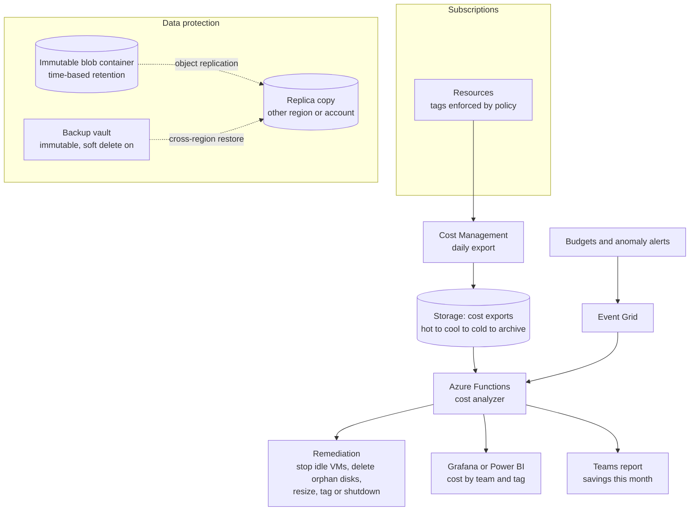
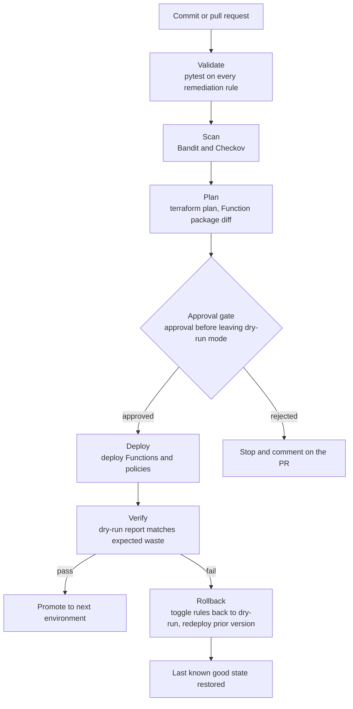
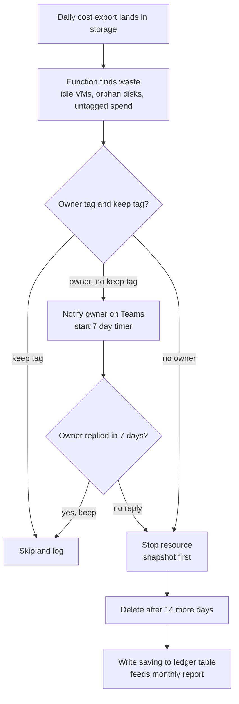

# Cost-Guarded Data Vault

A retention platform with tiered, immutable storage and a FinOps engine that reads the daily cost export and fixes waste automatically.

### Business use case

A company holds years of logs, documents and backups at hot-tier prices, cannot prove ransomware could not delete its backups, and has a growing cloud bill with no owner. The vault tiers data by age, makes backups tamper-proof, and gives every untagged resource a deadline.

### The hard piece

Automated remediation and cost optimisation

### Rough monthly cost, ZAR

R200 to R600 a month. Storage and Functions are cheap, so this is the project you can leave running.

### Tool stack

- Blob lifecycle management
- Blob versioning + soft delete
- Immutability policies (WORM) + legal hold
- GZRS and object replication
- Azure Backup vault (immutable)
- Cost Management exports
- Azure Functions (Python)
- Event Grid
- Logic Apps
- Resource Graph
- Advisor API
- Budgets + anomaly alerts
- Managed Grafana or Power BI
- Azure Policy (tags)
- Terraform
- GitHub Actions + OIDC
- pytest

### Diagrams

#### Diagram 1 · Architecture: tiered vault and cost engine

> **How to read this:** The top path is the cost loop: resources are tagged, the daily export lands in storage, a Function reads it and acts. The bottom box is the protection loop: backups go into a vault that nobody, including an admin, can shorten or delete during the retention window.

#### Diagram 2 · CI/CD: rules as code, dry run first

> **How to read this:** Follow the top line from a commit to a deploy: the pipeline stops at the first red step, and nothing reaches the approval gate unless validation, scanning and the plan all passed. The bottom branch is the one hiring managers ask about: when verification fails, the rollback box puts the environment back without a human editing the console. The unusual rule here is that production starts in dry-run: the verify step checks the report, and only then does a human flip the switch to act.

#### Diagram 3 · Hard piece: the remediation ladder

> **How to read this:** Every branch ends in either a skip or a snapshot-then-stop, never a surprise delete. The ledger table at the bottom is what turns this into a résumé line: it records each action and its estimated saving.

### How it covers the five focus areas

- **Compute** (light): Functions on a consumption or container plan, Container Apps jobs for heavy analysis, dev VMs and nonprod AKS stopped on a schedule, spot for batch.
- **Networking** (light): Storage firewall closed, private endpoints for blob and Key Vault, Functions VNet integrated, no public access allowed by policy.
- **Storage · HOME**: Lifecycle rules (hot, cool, cold, archive), versioning, soft delete, time-based and legal-hold immutability, GZRS or object replication, immutable backup vault, a documented rehydration procedure.
- **CI/CD** (deep): Remediation rules are unit-tested code; pipeline deploys in dry-run by default; policies for tags are shipped with the same pipeline.
- **Cost optimisation · HOME**: Cost exports, budgets and anomaly alerts, tag-based chargeback, idle and orphan cleanup, rightsizing from Advisor, a savings ledger, a monthly report.
### Advanced features that show depth

- Dry-run, notify, then act ladder with an owner tag and a grace period
- Savings ledger that records each action and its estimated saving
- Anomaly check comparing today's spend to a 28-day baseline per tag
- A WORM proof: a recorded attempt to delete a locked blob that fails
- Lifecycle simulation: estimate cost before and after tiering on your own data

### Production-like touches

- Monthly savings report posted automatically to Teams
- Runbook: restore from the immutable backup, step by step
- Post-incident write-up: a rule stopped the wrong VM and you added a keep-tag check
- Tests for every rule and a README that explains each safeguard

### AWS to Azure bridge

| AWS | Azure | Where it trips up AWS engineers |
| --- | --- | --- |
| S3 lifecycle + Intelligent-Tiering | Blob lifecycle management | Rules are age or last-access based. There is no automatic tiering service equivalent to Intelligent-Tiering, so you write the rules. |
| S3 Object Lock | Blob immutability policies | Set at container or version level. Locking a policy is irreversible, so test with an unlocked policy first. |
| AWS Backup vault lock | Backup vault immutability | Check which tier and soft-delete settings are required before enabling. |
| Cost Explorer + CUR | Cost Management + exports | Exports land as CSV or Parquet in a storage account. |
| Lambda + EventBridge | Functions + Event Grid | Same pattern, different bindings. |
| Trusted Advisor | Advisor | Recommendations are available through an API you can query. |

### Résumé pitch

- Built a FinOps automation that read daily cost exports and removed \[N\] idle resources, saving an estimated R\[N\] a month.
- Cut storage cost by \[N\]% with lifecycle tiering while keeping \[N\] days of immutable, ransomware-resistant retention.
- Enforced tagging through Azure Policy and delivered tag-based chargeback covering \[N\]% of spend.

> *Replace every \[N\] with a number you measured. If you cannot measure it, remove the claim.*
